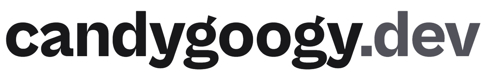

<p align="center">
  <picture>
    <source media="(prefers-color-scheme: dark)" srcset=".github/assets/wordmark-dark.png">
    
  </picture>
</p>

<p align="center"><b>The source of candygoogy's portfolio: the things I build, and the person who builds them.</b></p>

<p align="center">
  <a href="https://candygoogy.dev">Website</a> ·
  <a href="https://fettle.page">Fettle</a> ·
  <a href="mailto:hello@candygoogy.dev">hello@candygoogy.dev</a>
</p>

<p align="center">
  <a href="https://github.com/candygoogy/candygoogy.dev/actions/workflows/ci.yml"></a>
  <a href="LICENSE"></a>
  
</p>

A small, static site with one job: show what I've made, starting with [Fettle](https://fettle.page), and make it easy to get in touch.

- **Static.** Every page is plain HTML and CSS, built ahead of time. JavaScript only adds motion and small extras; the content is all there without it.
- **Private.** No analytics, no trackers, no cookies.
- **Light and dark themes,** following your system, with your pick remembered.
- **Accessible.** Built to WCAG 2.2 AA, usable by keyboard alone, and calm when you ask your system for reduced motion.

## How it's built

- **Site:** [Astro](https://astro.build), static output. A small theme script runs before the first paint, so the page never flashes the wrong theme; the rest of the interactive parts are small TypeScript scripts that load after it.
- **Hosting:** Cloudflare Workers static assets, on the apex domain only.
- **Deploys:** Workers Builds, from this repo's `main` branch.
- **Type:** Cabinet Grotesk and Satoshi, from [Fontshare](https://www.fontshare.com).
- **Discord status:** a small Worker route (`/api/presence`) asks [Lanyard](https://github.com/Phineas/lanyard) server-side and returns only online, idle, do not disturb or offline. Visitors' browsers only ever talk to candygoogy.dev.
- **Checks:** ESLint, Prettier and `astro check` on every push, in [CI](.github/workflows/ci.yml).

```text
src/
  content/projects/   one Markdown file per project
  content.config.ts   the schema every project must match
  layouts/            the page shell
  pages/              home, /fettle and the 404
scripts/fonts.mjs     fetches the fonts at build time
wrangler.jsonc        Cloudflare config (no account details)
```

## Develop

Requires Node 22.12 or newer.

```sh
npm ci
npm run dev        # fetch fonts, then the Astro dev server
npm run lint       # ESLint + Prettier check (never rewrites files)
npm run typecheck  # astro check
npm run build      # fetch fonts, then static output in dist/
npm run preview    # serve dist/ locally with Wrangler, as on Cloudflare
```

`npm run format` rewrites files with Prettier. It only runs when you call it.

### Adding a project

Projects live in `src/content/projects/`, one Markdown file each. The schema in `src/content.config.ts` fails the build on a missing or wrong field, so a broken entry never ships. My own projects can carry screenshots; websites built for clients are text only, and the build enforces that too.

## Fonts

The site uses Cabinet Grotesk and Satoshi from [Fontshare](https://www.fontshare.com), under the ITF Free Font License. That license doesn't allow redistributing the font files through a repository, so they aren't in this repo. `npm run fonts` downloads the official packages and copies the variable WOFF2 files, unmodified, into the gitignored `src/fonts/`, and Astro serves them from this domain. If the download fails or the license text changes, the build fails.

## License

- **Code** (everything that makes the site work) is under the [MIT License](LICENSE).
- **Content** (the writing, project descriptions, screenshots, images, logos and the candygoogy name and identity) is **© candygoogy, all rights reserved**. It isn't covered by the MIT License, so please don't reuse it without asking.
- The **avatar** artwork (contact card and site icon) is by [@dark_night1109](https://x.com/dark_night1109/status/2104328383211737219). It belongs to the artist and isn't covered by the © candygoogy content line or the MIT License. The avatar comes from the GitHub profile at build time; update this credit if it changes.
- The **Fettle** marks and screenshots belong to the Fettle project. Third-party names and sites mentioned here belong to their owners.
